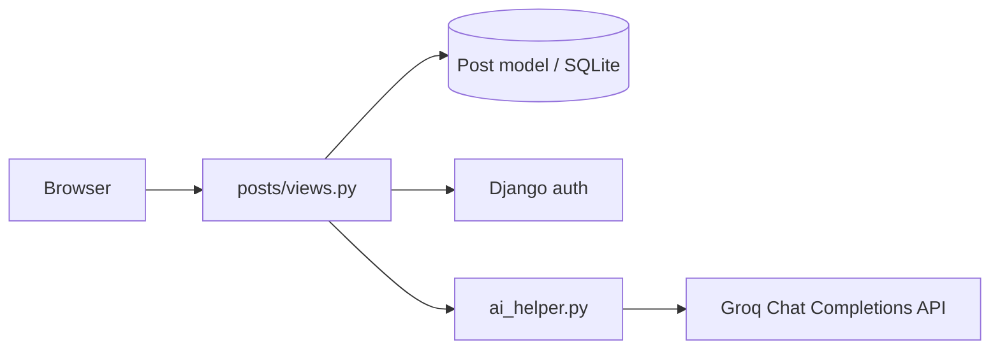

# Blog Platform

Django blog with public reading, authenticated authoring, author-scoped edit/delete, categories, and optional **Groq LLM** post summarization.

## Elevator pitch
A clean full-stack blogging starter that demonstrates Django auth, CRUD permissions, templates, and a practical AI assist endpoint.

## Architecture



## Tech stack
- Django 6
- SQLite (local default)
- Groq Python SDK for summaries
- Server-rendered templates

## Features
- Public post list & detail
- Login-required create / update / delete
- Author-only authorization on mutate paths
- Categories (tech, lifestyle, education, economy, other)
- AI summary page powered by Groq (`/posts/<id>/summary/`)

## Setup
```bash
git clone https://github.com/AbdulHakeem007/Blog.git
cd Blog
python -m venv .venv
source .venv/bin/activate  # Windows: .venv\Scripts\activate
pip install -r requirements.txt
cp .env.example .env
# put your Groq key in .env
python manage.py migrate
python manage.py createsuperuser
python manage.py runserver
```

## Environment
| Variable | Description |
|---|---|
| `GROQ_API_KEY` | Groq API key (required for summaries) |
| `GROQ_MODEL` | Model id (e.g. `llama-3.1-8b-instant`) |

## Key routes
| Path | Method | Auth | Purpose |
|---|---|---|---|
| `/` | GET | public | Post list |
| `/create/` | GET/POST | login | Create post |
| `/<id>/` | GET | public | Detail |
| `/<id>/edit/` | GET/POST | author | Update |
| `/<id>/del/` | GET/POST | author | Delete |
| `/<id>/summary/` | GET | login | AI summary |

## License
MIT — see [LICENSE](./LICENSE).
